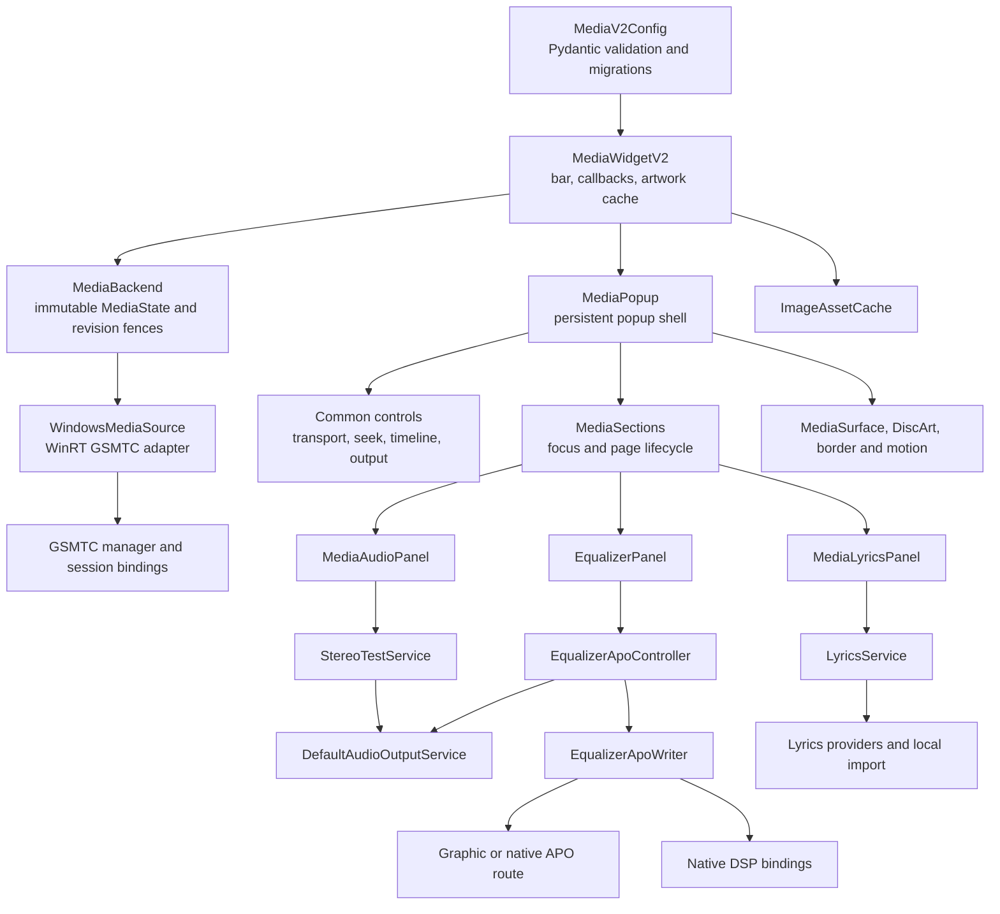
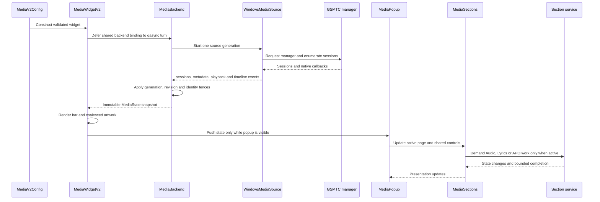
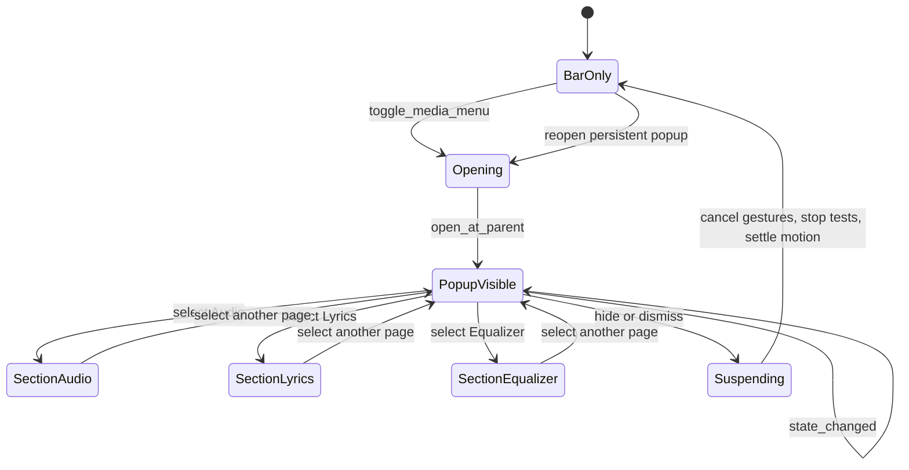
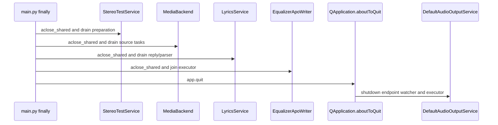

# Media V2 dependency, runtime flow and architecture review

18–19 November 2026. This record describes the current dirty checkout at
`E:\hi o\yasb`. It covers the source after the closed Lyrics and APO writer
singleton fixes. No live players, devices, profiles, Windows state, APO
targets or Git index state were changed.

## Dependency graph

The source locations are:

- Configuration at `src/core/validation/widgets/yasb/media_v2.py`.
- Bar owner at `src/core/widgets/yasb/media_v2.py`.
- Popup and shared controls at `src/core/widgets/yasb/media_v2_popup.py` and
  `src/core/widgets/yasb/media_v2_components.py`.
- Motion and marquee at `src/core/widgets/yasb/media_v2_motion.py`.
- Lower-page composition at `src/core/widgets/yasb/media_v2_sections.py`.
- Equalizer, Audio and Lyrics pages at `media_v2_equalizer.py`,
  `media_v2_audio.py` and `media_v2_lyrics.py`.
- Media state and service boundaries under `src/core/widgets/services/media/`.

## Runtime state flow

The backend is the state boundary. Windows callbacks never publish Qt widgets
or mutable WinRT objects across threads. The source owns native session
bindings. The backend owns immutable snapshots, selection and action fences.
The widget owns presentation and never becomes the media source owner.

Artwork follows a separate path. Metadata identifies the cache key, one shared
image cache coalesces decode and background preparation, and the GUI thread
creates the final `QPixmap`. A late decode is discarded when its artwork key or
widget lifetime no longer matches.

## Popup and section lifecycle

The popup is persistent under the Media V2 widget. Hiding it suspends section
input, stops the stereo test, cancels seek and Lyrics picker interaction, stops
marquees and capture clocks, and settles owned animations. Reopening reuses the
same presentation objects and rebinds closed singleton services when needed.

## Service and shutdown flow

`StereoTestService`, `LyricsService` and `EqualizerApoWriter` now distinguish a
direct closed singleton from an asynchronous shared shutdown that is still
draining. During drain, `shared()` returns the retiring object. After direct
shutdown, a later owner receives a fresh object. `MediaLyricsPanel` also
reacquires a closed cached Lyrics service.

## Risks and decisions

| Area | Current risk | Decision and evidence |
| --- | --- | --- |
| GSMTC track identity | Duplicate metadata can represent a new track while title, album and track number remain equal. | Keep the existing contract. GSMTC exposes no stable track ID. |
| GSMTC replacement | App-owned SMTC, WASAPI and Media Foundation do not preserve the cross-player contract. | Retain GSMTC as primary. WASAPI remains a diagnostic companion option. |
| Popup ownership | Persistent popup can outlive a directly shut-down shared service. | Default output, Lyrics and Audio/Test owners rebind closed services. |
| APO writer ownership | Direct writer shutdown could leave a later controller with a closed writer. | Closed-aware shared recreation with drain guard added. |
| Windows callbacks | Native callbacks can arrive after source retirement. | `_closed`, generation, binding and sample-version fences reject late work. |
| Artwork workers | Decode and background preparation can finish after metadata changes or widget destruction. | Cache keys, task coalescing and QObject lifetime gates reject stale results. |
| Popup timers and animations | Hidden popup could retain active motion, marquee, capture or test work. | Hide and suspend paths stop these owners. Existing receipts show zero settled timers, readers and jobs. |
| Default output executor | A COM query can finish after shutdown. | Closed state and generation checks discard late state. |
| Live DSP and providers | Offline persistence and synthetic frames cannot prove endpoint processing or provider availability. | Keep deployment preparation separate from live authorization. |
| Physical presentation | Offscreen and synthetic previews cannot establish compositor-presented frames or mixed-DPI parity. | Leave this as authorized native evidence. |

## Offline fixes in this review

- `LyricsService.shared()` now recreates a directly closed singleton while
  preserving the async drain contract.
- `MediaLyricsPanel` disconnects from and reacquires a closed Lyrics service.
- `EqualizerApoWriter.shared()` now recreates a directly closed writer while
  preserving the existing drain behavior.
- Added direct-shutdown regressions for the Lyrics service, Lyrics panel and
  APO writer.
- Shared Lyrics, APO writer and stereo-test drains now retain one owned drain
  task behind `asyncio.shield`. Cancelling a caller's wait cannot expose a
  closed owner while its worker or network reply is still retiring. Regression
  tests cover canceled writer and stereo drains, while the existing Lyrics
  cancellation test remains passing.

The media backend shared owner was audited separately. Its existing generation
and source-retirement fences were retained because the cancellation probe did
not reproduce a surviving native owner after `close()`.

## Verification

- Focused lifecycle regressions passed, including the existing asynchronous
  Lyrics drain-cancellation contract.
- The first full-suite rerun reached 2,755 passes and one expected AMD skip,
  then hit the known timing-sensitive section-reversal oracle. The exact case
  passed in isolation.
- The serial rerun passed **2,756 tests and one expected AMD skip** in 226.18
  seconds, with 1,963 qasync deprecation warnings.
- Strict Pyright analyzed 502 files with zero diagnostics. Ruff check and
  format check passed, with 509 files already formatted.
- The refreshed build exited 0 with the existing cx_Freeze missing-module and
  duplicate quick-launch warnings.
- Private package proof matched 31 production modules plus the ordinary entry,
  preserved 2,644 original ZIP entries and registered 60 schema widgets.
- The source-bound frozen preview exited 0 with popup, motion, Apply/discard,
  Lyrics, Audio, Test, timer, reader and clean-shutdown checks passing.
- The unchanged benchmark comparator passed every budget. Settled two-view CPU
  was **9.10% against 12%**, event-loop p95 was 1.03 ms, title-paint-start
  p95 was 15.02 ms, settled timers/readers/jobs were 0/0/0, private growth
  from cycle 8 to 24 was 204,800 bytes and handle/thread growth was 0/0.

The final architecture3 source manifest has 540 inputs and SHA-256
`e761115f4aac2d349feeb8d08dd1c3637b76510fc316c38a5f2ae6c09b55449b`.
